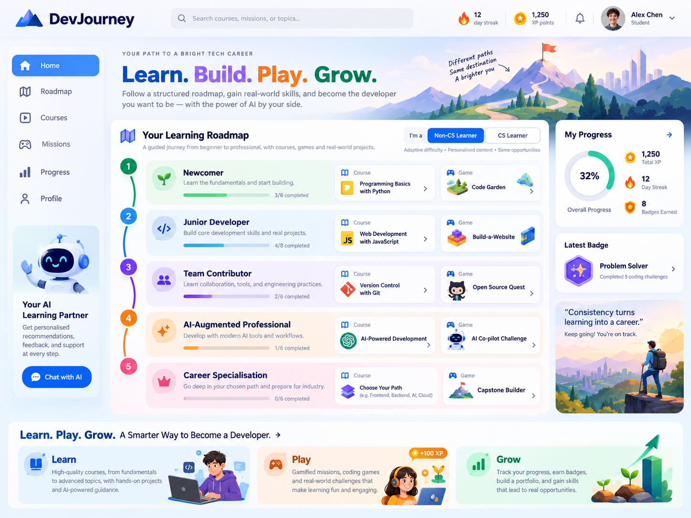

# DevJourney — Next.js + Django classroom prototype

**DevJourney** is a gamified software engineering learning platform based on the career-journey concept. Non-CS learners and CS graduates explore a shared foundation, then branch into either **Software Developer** or **Scrum Master** pathways. Each stage includes a mini-course and an interactive mission. Instructors can draft/edit courses, assign activities, and review demo student progress.

The project uses **Next.js App Router + TypeScript** for the frontend and **Python Django + SQLite** for the backend. It is a **local-first demonstration prototype**, not a production learning management system.



> The images in `docs/mockups` are earlier design references. The actual implemented UI is coded in `frontend/src` and may differ in detail.

## Quick start — macOS / Linux

Prerequisites: Node.js 20.9+ (22 LTS is fine), npm, Python 3.11+ (3.13 is fine), internet access *when installing packages*, and two free ports (8000 and 8080).

From the extracted folder:

```bash
chmod +x scripts/*.sh
./scripts/setup.sh
./scripts/dev.sh
```

Then visit **http://localhost:8080**. The backend serves **http://127.0.0.1:8000/api/health/**.

If you prefer separate terminals, use the steps below. For Windows, use the separate-terminal method.

## Manual setup — all operating systems

### Terminal 1 — Django backend

In the `backend` folder:

**macOS / Linux:**

```bash
cd backend
python3 -m venv .venv
source .venv/bin/activate
python -m pip install -r requirements.txt
python manage.py migrate
python manage.py seed_demo
python manage.py runserver 127.0.0.1:8000
```

**Windows PowerShell:**

```powershell
cd backend
py -m venv .venv
.venv\Scripts\Activate.ps1
python -m pip install -r requirements.txt
python manage.py migrate
python manage.py seed_demo
python manage.py runserver 127.0.0.1:8000
```

If PowerShell blocks activation, use `.venv\Scripts\python.exe` instead of `python` for each Django command (and `-m pip` for installation). Avoid changing system-wide script policy just for this app.

Leave this terminal running. You should see the Django development server listening on port **8000**.

Verify the API in your browser:

- http://127.0.0.1:8000/api/health/ should return `{"status":"ok","app":"DevJourney API"}`.
- http://127.0.0.1:8000/api/bootstrap/ should return demo career paths, stages, lessons and progress.

### Terminal 2 — Next.js frontend

Open a **second terminal**, then enter the `frontend` folder:

```bash
cd frontend
npm install
npm run dev
```

Open **http://localhost:8080**. If you are in the `frontend` folder already, skip `cd frontend`.

**Important:** Keep both terminals running. The Next.js app is served on **8080**; the Django API runs on **8000**. `frontend/next.config.ts` forwards browser requests from `/api/*` to Django, so no separate CORS setup is needed for local development.

## What you can try

1. Open the student dashboard at `/` and inspect the learning roadmap.
2. Go to `/paths`, switch between non-CS and CS background, and choose Developer or Scrum Master.
3. Open `/courses`, read the three lessons in a course, click **Finish course**, and confirm the dashboard and XP update.
4. Open `/missions`. In **Sprint Planning Challenge**, add or drag four essential tasks into the backlog and submit. Most other missions are scenario-based multiple choice questions.
5. Open `/instructor` using the **Instructor view** link in the left sidebar.
6. Visit `/instructor/create`, create a mini-course, and use **Review & edit course** to change its lessons.
7. Visit `/instructor/assignments`, assign a course or mission to Class A or B, and see it appear in the instructor dashboard.
8. Ask the AI tutor a question in an activity. With no API key, the tutor explicitly returns an **offline demo hint**.

Demo student: **Alex Chen**. The app uses demo profiles rather than real accounts. Other students are seeded for instructor analytics.

## Optional: connect an actual LLM

The project works without an AI key. For live content drafting and AI tutor answers, export an **OpenAI API key on the Django server only** before starting Django:

**macOS / Linux:**

```bash
export OPENAI_API_KEY="your-key-here"
export OPENAI_MODEL="gpt-4o-mini"
python manage.py runserver 127.0.0.1:8000
```

**Windows PowerShell:**

```powershell
$env:OPENAI_API_KEY="your-key-here"
$env:OPENAI_MODEL="gpt-4o-mini"
python manage.py runserver 127.0.0.1:8000
```

The backend uses the OpenAI Chat Completions API via Python's standard library; there is no browser-exposed secret. If no key is configured or a request fails, the server falls back to an explicitly labelled **local template**, not an LLM result. Live model usage requires network access and may incur costs. Do not commit secrets to GitHub.

## Key folders

```text
devjourney-fullstack/
├── backend/
│   ├── config/                 Django configuration and URLs
│   ├── learning/
│   │   ├── models.py            Paths, stages, content, learners, completions, assignments
│   │   ├── views.py             JSON API and optional AI integration
│   │   ├── urls.py              API routes
│   │   ├── tests.py             Django API tests
│   │   ├── migrations/          Initial database schema
│   │   └── management/commands/seed_demo.py
│   ├── manage.py
│   └── requirements.txt
├── frontend/
│   ├── src/app/                Next.js routes and global CSS
│   ├── src/components/         App shell, roadmap, games, courses, instructor UI
│   ├── src/lib/types.ts        Typed API helper and shared data types
│   ├── next.config.ts          Rewrites /api/* → Django port 8000
│   └── package.json
├── docs/mockups/               Design reference pictures
└── scripts/                    macOS/Linux setup and dev launch scripts
```

## Main browser routes

| Route | Purpose |
| --- | --- |
| `/` | Student dashboard |
| `/roadmap` | Career roadmap with courses and games per stage |
| `/paths` | Background selection and Developer/Scrum Master tracks |
| `/courses` | Course catalogue |
| `/courses/<slug>` | Three-step lesson viewer and course completion |
| `/missions` | Interactive mission catalogue |
| `/missions/<slug>` | Sprint backlog game or scenario decision |
| `/progress` | Personal milestones, XP and achievements |
| `/instructor` | Instructor dashboard and class statistics |
| `/instructor/create` | Draft mini-course with AI or an offline template |
| `/instructor/edit/<slug>` | Edit course title, summary and lessons |
| `/instructor/assignments` | Assign a course or game to a demo class |

## API endpoints

| Method | API route | Purpose |
| --- | --- | --- |
| GET | `/api/health/` | API health check |
| GET | `/api/bootstrap/` | Student dashboard, paths, progress, instructor data |
| PATCH | `/api/learner/` | Change demo student's background and selected path |
| GET | `/api/items/<slug>/` | Fetch course or mission content |
| POST | `/api/items/<slug>/complete/` | Evaluate mission or mark course complete and award XP |
| POST | `/api/instructor/assignments/` | Create assignment |
| POST | `/api/instructor/courses/` | Draft a mini-course |
| PATCH | `/api/instructor/courses/<slug>/` | Edit an existing course |
| POST | `/api/ai/tutor/` | Optional AI tutor or labelled offline demo hint |

## Running tests

Django tests (with activated Python environment, from `backend`):

```bash
python manage.py test learning
python manage.py check
```

Frontend validation (after npm installation, from `frontend`):

```bash
npm run lint
npm run build
```

## Common problems

- **`Error: Cannot reach the Django API`**: Django is not running on port 8000, or you forgot `python manage.py migrate` / `python manage.py seed_demo`.
- **`ModuleNotFoundError: No module named 'django'`**: Activate the Python virtual environment and install `backend/requirements.txt`.
- **`next: command not found`**: Run `npm install` inside `frontend`.
- **`EADDRINUSE` on port 8080 / `port already in use`**: Stop the existing process on that port, or adjust ports consistently in both Next.js scripts and API proxy configuration.
- **`No module named django` after opening a new terminal**: Activate `.venv` again.
- **AI still uses an offline template**: Check that `OPENAI_API_KEY` is set in the terminal where Django starts, and verify access to the API. Without a key, offline behavior is expected.
- **Reset demo records**: Stop Django, delete `backend/db.sqlite3`, then run `python manage.py migrate` and `python manage.py seed_demo` again. This deletes local progress and instructor-created courses.

## Demo/production boundary

This is an academic proof of concept. It **does not have real sign-in, authorisation, per-student assignment visibility, enrolment rules, secure CSRF-protected authenticated write APIs, production deployment configuration, or a full role-play engine**. All changes affect shared demo records. Do not deploy this unchanged on a public server. Before production use, implement authenticated user accounts, permission checks, CSRF/session strategy, robust input validation, secrets management, rate limits, safer AI outputs, PostgreSQL and deployment configuration.

## Design and academic positioning

The current prototype demonstrates:
- One integrated app for both learners and instructors.
- Two careers sharing common software engineering and AI fluency foundations.
- Courses and games attached to a visible roadmap.
- Learner progress persisted to SQLite and visible as class metrics.
- Realistic task-based challenges, not only passive quizzes.
- Instructor course creation/editing and assignments.

Suggested next iterations: richer adaptive difficulty (currently background is recorded and shown but does not change lesson content), AI-powered branching workplace role play, learner accounts, real assignment enforcement, instructor engagement analytics, badges based on mastery, and better accessibility testing.

